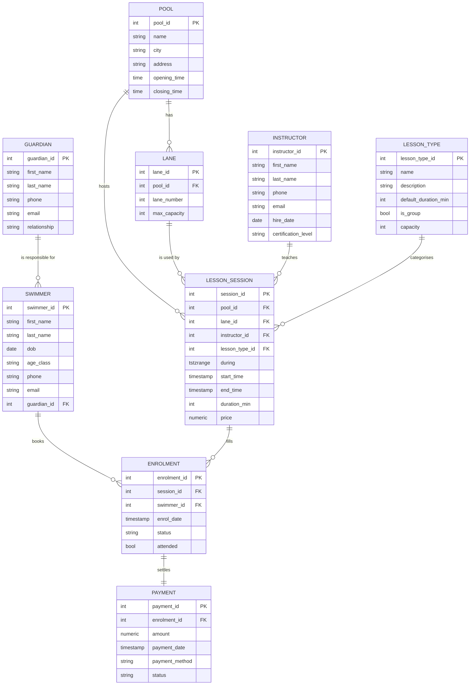

# Portfolio 1 — Database Design and Modelling

**Student:** Fatima Toko Ali · 2026/A/MIT/0873
**Case study:** SplashPoint Swim School (simulated) — pools in Abuja (Wuse, Maitama) and Lagos (Ikoyi, Lekki).
**Study session covered:** ER modelling, relational mapping, normalisation (1NF/2NF/3NF), integrity constraints & triggers, physical design basics.

---

## What this portfolio demonstrates

A complete normalised relational schema for SplashPoint Swim School with:

- **9 tables in 3NF:** `pool`, `lane`, `instructor`, `swimmer`, `guardian`, `lesson_type`, `lesson_session`, `enrolment`, `payment`.
- **Two exclusion constraints** on a `tstzrange` (with `btree_gist`) that prevent (i) overlapping sessions in the same lane and (ii) the same instructor teaching two overlapping sessions.
- **Two triggers:** a group session cannot exceed its capacity (e.g. max 6 swimmers); a swimmer under 18 must have a guardian.
- **CHECK constraints:** sessions only between 06:00 and 20:00, sessions 30–60 minutes long, payment amount > 0.
- A small hand-crafted seed (`seed.sql`) and a **bulk generator** (`bulk_generate.py`) that emits **60,000 enrolments over 2 years plus the next 14 days** with no lane or instructor overlaps, no over-capacity sessions, realistic Nigerian names and ₦ prices.
- A `constraints_test.sql` file in which **every test must FAIL** — proving every constraint actually fires.

## ER diagram

(Rendered by GitHub from the block below; the same source is in `er_diagram.mmd`.)



---

## Files

| File | Purpose |
| --- | --- |
| `er_diagram.mmd` | Mermaid ER diagram (render in any Mermaid viewer, e.g. GitHub). |
| `schema.sql` | Drops & creates all 9 tables, all constraints, both triggers, both trigger functions. |
| `normalisation.md` | Walk-through of 1NF → 2NF → 3NF for the schema. |
| `seed.sql` | Small hand-crafted seed used to sanity-check the schema; the bulk load then replaces it (TRUNCATE) with the full data set. |
| `bulk_generate.py` | Python script that emits `pools.csv`, `lanes.csv`, `instructors.csv`, `swimmers.csv`, `guardians.csv`, `lesson_types.csv`, `lesson_sessions.csv`, `enrolments.csv`, `payments.csv` into `bulk_data/`. 50,000+ enrolments across 2 years. Uses dates relative to today. |
| `bulk_load.sql` | `\copy` loader that ingests the CSVs into the schema. |
| `constraints_test.sql` | 17 tests that must each FAIL with a specific error, plus 1 control that must succeed. Each test builds its own situation from the real data, and everything is rolled back at the end. |
| `run_p1.sh` | One-shot runner (`set -euo pipefail`); also prints `\d` of the key tables as evidence. |

---

## Exact Codespaces commands

Run from the repo root:

```bash
# 0. one-time setup (installs PostgreSQL 16 + MongoDB 8, creates 'splashpoint' db)
bash setup.sh

# 1. run portfolio 1 end-to-end
bash portfolio-1-database-design/run_p1.sh
```

What `run_p1.sh` does, step by step:

```bash
cd portfolio-1-database-design

# 1a. (re)create the schema
sudo runuser -u postgres -- psql -h /var/run/postgresql -d splashpoint -v ON_ERROR_STOP=1 -f schema.sql

# 1b. load the small hand-crafted seed
sudo runuser -u postgres -- psql -h /var/run/postgresql -d splashpoint -v ON_ERROR_STOP=1 -f seed.sql

# 1c. generate 50,000+ enrolments (uses dates relative to today)
python3 bulk_generate.py

# 1d. bulk-load them
psql -h /var/run/postgresql -d splashpoint -v ON_ERROR_STOP=1 -f bulk_load.sql   # as you, so \copy can read bulk_data/

# 1e. verify row counts
sudo runuser -u postgres -- psql -h /var/run/postgresql -d splashpoint -c "
  SELECT 'pool' AS t, count(*) FROM pool
  UNION ALL SELECT 'lane', count(*) FROM lane
  UNION ALL SELECT 'instructor', count(*) FROM instructor
  UNION ALL SELECT 'swimmer', count(*) FROM swimmer
  UNION ALL SELECT 'guardian', count(*) FROM guardian
  UNION ALL SELECT 'lesson_type', count(*) FROM lesson_type
  UNION ALL SELECT 'lesson_session', count(*) FROM lesson_session
  UNION ALL SELECT 'enrolment', count(*) FROM enrolment
  UNION ALL SELECT 'payment', count(*) FROM payment
  ORDER BY t;"

# 1f. run the constraint tests (each must FAIL)
sudo runuser -u postgres -- psql -h /var/run/postgresql -d splashpoint -v ON_ERROR_STOP=0 -f constraints_test.sql
```

---

## What to screenshot (for the final PDF)

1. The ER diagram as GitHub renders it in this README.
2. The output of the row-count verification query above (must show 50,000+ enrolments).
3. The terminal output of `constraints_test.sql` — must show **every test failing** with the expected error class (exclusion violation, check violation, foreign key violation, etc.).
4. The `\d lesson_session` output showing the two exclusion constraints and the CHECK constraints.
5. The `\d+ enrolment` and `\d+ swimmer` outputs showing the triggers.

---

## Git commit command

```bash
git add portfolio-1-database-design/
git commit -m "P1: ER diagram, 3NF schema (9 tables), exclusion constraints on tstzrange, triggers, 50k+ bulk enrolments, constraint tests that fail"
git push
```

---

## Plain-English explanation

SplashPoint books swimming lessons. A **lesson session** is a class held by exactly one instructor in exactly one lane of a specific pool, at a specific start–end time. Sessions are 30–60 minutes long and may only run between 06:00 and 20:00. A **swimmer** books a place in a session via an **enrolment**, and each enrolment has a **payment**. Swimmers under 18 must have a **guardian** on file. Group sessions (private vs group vs adult-beginner) have a **capacity** that the enrolment count cannot exceed.

The two hardest constraints are the **no-overlap** rules:

- *No two sessions may overlap in the same lane.* If lane 3 at Ikoyi has a session 10:00–10:45, you cannot insert another session 10:30–11:15 in lane 3 at Ikoyi.
- *No instructor may teach two overlapping sessions.* If Adaora is teaching 10:00–10:45 at Wuse, she cannot also be booked 10:30–11:15 at Maitama.

Both are enforced by **exclusion constraints** on a `tstzrange` column `during` (using the `btree_gist` extension, which lets GiST index scalar columns like `lane_id` and `instructor_id` alongside the range). An exclusion constraint says "no two rows may overlap on these columns AND have overlapping ranges". This is the canonical PostgreSQL idiom for scheduling and is far cheaper than a serialisable transaction for every booking.

The capacity rule and the under-18-must-have-guardian rule are enforced by **triggers**, because they require counting related rows / inspecting another table — neither can be expressed as a CHECK or exclusion constraint.
